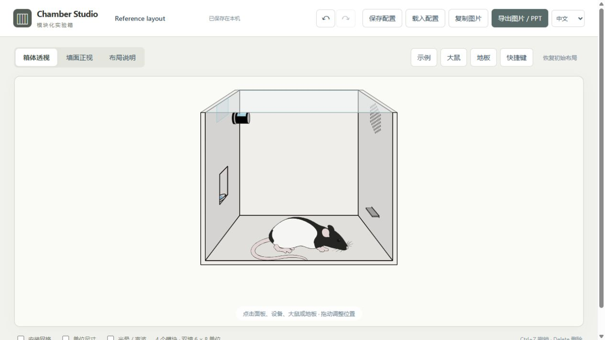

# Chamber Studio · 模块化实验箱绘图工具

**直接点击箱体配置零件，导出仍可编辑的实验示意图。**

[打开在线工具](https://zhang-mengjia.github.io/chamber-studio/) · [English](README.md) · [详细使用说明](docs/guide.zh-CN.md) · [问题反馈](https://github.com/zhang-mengjia/chamber-studio/issues)



免费开源，无需注册。左右墙面各为 6 × 8 单位，每面墙由三列宽 2 单位的模块组成。直接点击透视图或墙面正视图，在点击处附近配置模块，拖动即可移动；支持撤销、重做、复制、剪切、粘贴及删除。

## 立即使用

1. 打开在线工具，顶部可切换 **中文 / English**。
2. 点击空白面板安装模块；点击设备设置状态、食物口味、水量、声波类型等参数。
3. 点击地板选择平面地板、金属横杠或多孔亚克力；点击黑白大鼠，通过缩略图切换站立、行走、后足直立、低头嗅探和坐姿。五种姿势均已重绘为参考图风格的矢量曲线，支持移动、等比缩放、左右翻转及隐藏，切换姿势时脚底位置保持稳定。箱体统一采用暖灰墙面、细黑轮廓和平面色块，复用参考 PPT 中的箱体、灯体、孔阵喇叭和水杯曲线，保留参考图视角并铺满完整安装范围。压杆沿墙面固定，水平伸入箱内，并绘制相连的厚度面。大鼠和设备按观察方向的远近排序，透明顶板与前框覆盖内部对象；预览和导出共用这一图层顺序。
4. 选择透视、正视或布局说明视图，再导出 **PPT、PDF、PNG**。使用“保存配置”下载可再次载入的 JSON。

“示例”内置参考图、双水槽、操作性条件反射、空白箱体四种布局，载入后可撤销。

## 支持的零件

食槽、水槽、喇叭为 2 × 2；鼻戳、压杆、房灯、信号灯、摄像头为 2 × 1。

- 食物：空槽或有食物；谷物、蔗糖、巧克力、香蕉、草莓。
- 水量：空槽或 10、20、40、80、160 μL。
- 压杆：伸出 / 缩回。鼻戳和信号灯：开 / 关。
- 房灯：关闭 / 常亮 / 闪烁，0.2–5 Hz；静态导出用点亮灯体。
- 喇叭：静音 / 播放，支持 Clicker、Siren、White noise、Pure tone 示意。
- 摄像头：关闭 / 录像。

PPT 使用原生自由曲线和文字，设备和大鼠均按组件组合，可进入或取消组合编辑内部曲线和填色。PDF / SVG 保留箱体与五种大鼠的完整矢量，SVG 可离线独立使用。PNG 可选三档分辨率和透明背景。绘图和导出均不显示部件文字标注，包括水量、食物口味、声音名称和闪烁频率；点击部件仍可查看和调整参数，配置文件保留这些设置。旧配置即使启用了文字标注，也按无部件标注方式绘制。

箱体透视图保留参考图视角及约 1.124:1 的宽高比例，PNG 可导出 608 × 542、1216 × 1083 或 1824 × 1624；按实际绘图边界裁紧。SVG、PDF 与 PPT 使用同一绘图范围。每面墙 3 列 8 排全部可安装，没有顶部空带；单排模块的宽高比为 2:1，双排模块为 1:1，正视图与布局说明中的正视墙面采用等比例坐标，透视图沿参考图的完整侧墙投影。双排部件拖到顶边或底边时会吸附到完整部件可容纳的位置，已有部件仍受保护。显示外部尺寸或将大鼠移到箱体之外时，导出边界会扩展以保留这些内容。参见[绘图风格与可编辑样例](docs/illustration-style.md)。

点击顶部「复制图片」可将当前视图直接复制为 PNG，粘贴到 Word、PPT 或聊天窗口。复制沿用导出菜单中的 PNG 分辨率和透明背景设置，需要浏览器在 HTTPS 或 localhost 下支持并允许写入剪贴板。

## AI 访问

AI 可通过带版本号的浏览器接口读取实验箱、批量修改布局、撤销重做，并导出 JSON、SVG、PNG、PDF 或原生可编辑的 PPTX：

```js
await window.chamberStudio.callTool('chamber_get_state', {});
```

[AI 接口控制台](https://zhang-mengjia.github.io/chamber-studio/ai.html)提供可直接填写 JSON 的工具表单与实验箱预览，不需要通过坐标点击绘制。浏览器提供 WebMCP 时会自动注册同样的八个工具；普通浏览器仍可使用 JavaScript 接口或控制台。

详细调用方式见[接口文档](public/api/README.md)，工具和参数可从[公开 manifest](https://zhang-mengjia.github.io/chamber-studio/api/manifest.json)、[配置 schema](public/api/config.schema.json)及 [llms.txt](https://zhang-mengjia.github.io/chamber-studio/llms.txt)读取。[标准 SKILL.md](public/skills/chamber-studio/SKILL.md)随项目提供，可将整个 `public/skills/chamber-studio/` 目录复制到 AI 的 skill 目录。HTTP 提供静态文档；执行工具需要打开浏览器页面，操作保存在当前浏览器中。

## 离线运行

从仓库 **Code → Download ZIP** 或[发布页](https://github.com/zhang-mengjia/chamber-studio/releases)下载并解压，准备 **Node.js 22 或以上**。

- Windows：双击 `start.cmd` 或 `启动网页.cmd`；运行 `停止服务.ps1` 可停止后台服务。
- Windows / macOS / Linux：在项目目录打开终端，执行 `npm start`，再访问 **http://127.0.0.1:47831/**。按 Ctrl+C 停止终端服务。

无需 `npm install`、构建或联网。请通过本地服务访问，不要直接双击 `index.html`。建议使用当前版本的 Chrome、Edge、Firefox 或 Safari；桌面浏览器更适合精确编辑。

## 数据与快捷键

配置和导出均在浏览器本地处理，无账号、埋点或配置上传接口。当前配置自动保存在此浏览器中；清除网站数据会删除它，请用“保存配置”备份。在线版与本机版的浏览器存储独立，可用配置文件转移。

支持 Ctrl+Z 撤销、Ctrl+Y / Ctrl+Shift+Z 重做、Delete 删除、Ctrl+C/X/V 复制剪切粘贴、方向键移动、Esc 取消、Ctrl+S 保存配置。macOS 可用 Command 对应 Ctrl。输入框保留文字编辑快捷键。

液面、光晕、食物颜色及声波仅作示意；工具不控制真实实验硬件，也不播放音频。

## 开发与许可证

执行 `npm test` 运行检查；项目无需构建。贡献指南见 [CONTRIBUTING.md](CONTRIBUTING.md)，可用中文或英文反馈问题。

代码与文档采用 **MIT**，署名 **zhang-mengjia**。LE 大鼠姿势素材单独采用 **[CC BY 4.0](https://creativecommons.org/licenses/by/4.0/)**，署名 **zhang-mengjia**。公开分享包含大鼠的图或改编素材时，请在图注或随附材料中保留作者、来源和许可证链接，并说明改动。参见[素材授权](public/assets/ATTRIBUTION.md)与[第三方许可证说明](THIRD_PARTY_NOTICES.md)。
